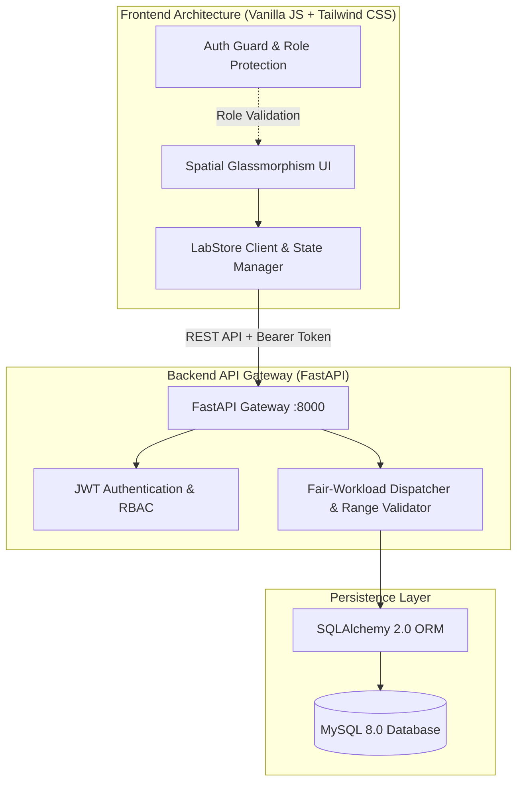

# LabLine — Clinical Diagnostic & Specimen Intelligence Platform

[](https://labline-8p02.onrender.com)
[](https://fastapi.tiangolo.com)
[](https://www.python.org)
[](https://www.sqlalchemy.org)
[](https://www.mysql.com)
[](https://www.docker.com)
[](https://tailwindcss.com)
[](https://jwt.io)

> **LabLine** is an enterprise-grade clinical Laboratory Information Management System (LIMS) and diagnostic platform. It unifies patients, phlebotomists, laboratory technicians, and pathology administrators into an automated specimen lifecycle—featuring intelligent workload balancing, clinical reference range validation, tamper-evident SHA-256 report verification, and modern glassmorphic web portals.

---

## 🚀 Live Demo & Deployment

LabLine is actively deployed and available online on **Render** using a unified container architecture serving both the FastAPI REST engine and the spatial glassmorphism client.

| Resource | Live Link | Description |
| :--- | :--- | :--- |
| **🌐 Full-Stack Web App** | **[https://labline-8p02.onrender.com](https://labline-8p02.onrender.com)** | Unified clinical diagnostic & management platform |
| **📚 Interactive API Docs** | **[https://labline-8p02.onrender.com/docs](https://labline-8p02.onrender.com/docs)** | OpenAPI Swagger documentation & API testing console |
| **🩺 Health & Uptime** | **[https://labline-8p02.onrender.com/health](https://labline-8p02.onrender.com/health)** | Real-time JSON health check & diagnostic telemetry |
| **🔍 Cryptographic Verifier** | **[https://labline-8p02.onrender.com/patient/verify.html](https://labline-8p02.onrender.com/patient/verify.html)** | Public SHA-256 report anti-tamper verification tool |

---

## Highlights & Role Portals

| Portal | Target Audience | Primary Features | Live Demo Link |
| :--- | :--- | :--- | :--- |
| **🩺 Patient Portal** | Patients & Clients | Interactive diagnostic catalog (28+ tests), smart prescription keyword parser, slot booking, live 5-stage specimen tracking, PDF report downloads, and public QR verification. | [Open Portal](https://labline-8p02.onrender.com/patient/catalog.html) |
| **🔬 Lab Workstation** | Lab Technicians | Urgency-sorted worklist, clinical tube identification (EDTA, Serum, Heparin), numerical biomarker entry, real-time biological range validation, and one-click cryptographic certification. | [Open Workstation](https://labline-8p02.onrender.com/technician/queue.html) |
| **🛡️ Admin Console** | Pathology Directors | Real-time operations KPI telemetry, automated fair-workload priority dispatcher, dynamic test catalog management, and technician queue management. | [Open Console](https://labline-8p02.onrender.com/admin/dashboard.html) |

---

## System Architecture



### Technology Stack

* **Backend Engine:** FastAPI (Python 3.10+), Uvicorn ASGI server
* **Persistence & ORM:** MySQL 8.0, SQLAlchemy 2.0, PyMySQL
* **Security & Auth:** PyJWT (Bearer tokens), Passlib (bcrypt password hashing)
* **Data Serialization:** Pydantic v2
* **Frontend:** Semantic HTML5, Vanilla JavaScript (ES6+), Tailwind CSS, Custom Glassmorphism System
* **Report Generation:** ReportLab & native browser print rendering
* **DevOps & Containers:** Docker, Docker Compose, Procfile-ready for cloud deployments

---

## Specimen Lifecycle & Verification

### 1. Five-Stage Specimen Pipeline
```
[Booked] ➔ [Sample Collected] ➔ [In-Transit] ➔ [Processing] ➔ [Results Certified]
```
1. **Booked:** Order created with a unique order ID (`ORD-XXXXXX`) and phlebotomist allocated.
2. **Sample Collected:** Specimen drawn in color-coded vacuum tubes (Purple EDTA, Gold Serum, etc.) and barcoded.
3. **In-Transit:** Specimen logged and tracked with temperature and transit telemetry.
4. **Processing:** Technician enters observed biomarker values; system validates against healthy biological reference limits.
5. **Results Certified:** Report locked with a digital certification stamp and immutable SHA-256 signature.

### 2. Cryptographic Integrity & Anti-Tamper Verification
Every certified report generates an immutable canonical JSON digest. If any result, reference limit, or timestamp is modified by even a single character, the public validator (`/patient/verify.html`) flags a cryptographic mismatch instantly.

---

## Quickstart Guide

### Option A: Run with Docker Compose (Fastest)

Clone the repository and start the complete multi-container stack (MySQL + FastAPI + Frontend):

```bash
docker compose up --build
```

* **Interactive Full-Stack Web App:** [http://localhost:8000/](http://localhost:8000/)
* **Interactive API & Swagger Docs:** [http://localhost:8000/docs](http://localhost:8000/docs)
* **System Health Monitor:** [http://localhost:8000/health](http://localhost:8000/health)

---

### Option B: Local Setup (Unified or Decoupled)

#### 1. Backend Setup (FastAPI & Database)

```bash
# Navigate to backend
cd backend

# Create and activate virtual environment
python -m venv venv
# On Windows:
.\venv\Scripts\Activate.ps1
# On macOS/Linux:
source venv/bin/activate

# Install dependencies
pip install -r requirements.txt

# Setup environment configuration
cp .env.example .env

# Start FastAPI server
uvicorn main:app --reload --port 8000
```
> **Unified Zero-Config Experience:** The FastAPI server automatically detects `../frontend` and serves the entire responsive web app directly at **[http://127.0.0.1:8000/](http://127.0.0.1:8000/)**! All schema tables and initial diagnostic catalogs are seeded on first launch.

#### 2. Optional: Decoupled Frontend Dev Server

If you prefer developing the frontend with a separate static live server:

```bash
# In a separate terminal
cd frontend
python -m http.server 5500
```
Open **[http://127.0.0.1:5500/index.html](http://127.0.0.1:5500/index.html)** in your browser. The client automatically discovers the backend at `http://127.0.0.1:8000`.

---

### Cloud Deployment

> **⚡ Active Production Host:** LabLine is deployed live on Render at **[https://labline-8p02.onrender.com](https://labline-8p02.onrender.com)** using the unified full-stack root `Dockerfile`.

#### 1. Render.com / Railway.app / Fly.io (Single-Container Full-Stack)
1. Fork or push this repository to GitHub.
2. In your cloud dashboard, create a new **Web Service** connected to your repository.
3. Configure the environment variables:
   * `DATABASE_URL`: Your hosted MySQL or PostgreSQL connection string (or omit for SQLite).
   * `JWT_SECRET_KEY`: A secure 32+ character random secret.
   * `ENVIRONMENT`: `production`
4. The service will build via the root `Dockerfile` (or `Procfile`), run on `$PORT`, and serve both the REST API and the frontend client simultaneously.

#### 2. Decoupled Deployment (Vercel / Netlify + Backend PaaS)
* **Frontend:** Deploy the `frontend/` directory to Vercel or Netlify as a static site. No build command required.
* **Backend:** Deploy the `backend/` directory to Render or Railway.
* **API Auto-Discovery:** Either pass `?api=https://labline-8p02.onrender.com` in your browser URL or add `<meta name="labline-api-base" content="https://labline-8p02.onrender.com">` in `frontend/index.html`.

---

## Demo Credentials

Pre-seeded accounts available for testing directly on **[https://labline-8p02.onrender.com](https://labline-8p02.onrender.com)**:

| Role | Email | Password | Live Access Link |
| :--- | :--- | :--- | :--- |
| **System Admin** | `admin@labline.com` | `admin123` | [Open Admin Portal](https://labline-8p02.onrender.com/admin/dashboard.html) |
| **Lab Technician** | `yashasrao@gmail.com` | `tech123` | [Open Technician Workstation](https://labline-8p02.onrender.com/technician/queue.html) |
| **Patient** | `nithinshetty1166@gmail.com` | `patient123` | [Open Patient Catalog](https://labline-8p02.onrender.com/patient/catalog.html) |

*(New patient and staff accounts can also be registered directly via the [Live Registration Portal](https://labline-8p02.onrender.com/index.html)).*

---

## Repository Structure

```plaintext
ddp/
├── backend/
│   ├── routers/               # Modular API routes (Auth, Bookings, Tests, Results, etc.)
│   ├── auth.py                # Password hashing & JWT token security
│   ├── database.py            # Database engine & connection pooling
│   ├── dependencies.py        # RBAC & database session injection
│   ├── main.py                # App entry point, CORS & startup catalog seed
│   ├── models.py              # Relational database models
│   ├── schemas.py             # Pydantic validation schemas
│   ├── Dockerfile             # Production container recipe
│   ├── Procfile               # Cloud PaaS process definition
│   └── requirements.txt       # Python dependencies
├── frontend/
│   ├── admin/                 # Administrator dashboard & catalog management
│   ├── patient/               # Test catalog, tracking, checkout, reports, & verify
│   ├── technician/            # Specimen processing queue & result entry
│   ├── css/                   # Spatial design tokens & animations
│   ├── js/                    # Shared LabStore client & auth guards
│   └── index.html             # Landing page & unified login portal
├── docker-compose.yml         # Containerized multi-service deployment
└── README.md                  # Project documentation
```

---

## Deployment Ready

* **Docker & Containers:** Production-ready `Dockerfile` with multi-stage caching and clean `.dockerignore`.
* **Cloud PaaS Platforms:** Includes `Procfile` for one-click deployment on Render, Railway, Heroku, or Fly.io.
* **Health Endpoints:** Automated `/health` endpoint for uptime monitors and load balancer readiness checks.

---

<div align="center">
  <sub>Developed by <a href="https://github.com/nithin16-cloud">Nithin T</a></sub>
</div>
