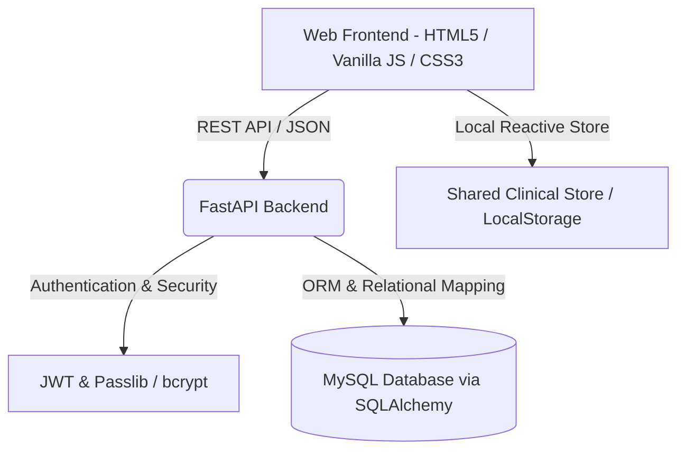

# 🔬 LabLine — Healthcare Diagnostic & Laboratory Information System (LIS)

[](https://fastapi.tiangolo.com)
[](https://www.python.org)
[](https://www.sqlalchemy.org)
[](https://www.mysql.com)
[](https://tailwindcss.com)
[](https://jwt.io)
[](https://html.spec.whatwg.org)
[](https://developer.mozilla.org/en-US/docs/Web/JavaScript)

---

**Project Title:** LabLine — End-to-End Clinical Diagnostic & Specimen Management Platform  
**Developer:** Nithin T  
**Domain:** Healthcare Informatics / Web Development  

---

## 📋 1. Project Overview & Problem Statement

In conventional clinical diagnostics, specimen collection, laboratory analysis, biological range validation, and certified report delivery are often managed across fragmented and manual systems. This can lead to sample misplacement, delayed turnaround times, transcription errors, and difficulty in communicating critical biomarker flags to patients and pathologists.

**LabLine** is a web-based Laboratory Information System (LIS) designed to automate and streamline the full diagnostic lifecycle. It provides dedicated role-based portals for **Patients**, **Laboratory Technicians**, and **Clinical Administrators** with real-time specimen tracking, automated biological reference interval validation, out-of-range critical flagging, and certified diagnostic report generation.

---

## 🎯 2. Project Objectives

- **Patient Portal:** Enable patients to browse diagnostic test panels, schedule doorstep phlebotomy or center visits, track specimen lifecycle stages in real time, and view/download certified laboratory reports.
- **Technician Workstation:** Provide laboratory technicians with prioritized specimen intake queues (STAT vs Routine), automated barcode indexing, parameter-by-parameter clinical result input, and instant out-of-range validation against CLSI reference intervals.
- **Admin Management Console:** Enable laboratory supervisors to monitor operational telemetry (daily throughput, turnaround times, revenue metrics), dispatch phlebotomist field routes, and manage diagnostic test tariffs and parameters.

---

## 🏗️ 3. System Architecture & Tech Stack



### 💻 Technology Breakdown

| Layer | Technology | Purpose |
| :--- | :--- | :--- |
| **Backend Framework** | **FastAPI (Python 3.10+)** | High-performance asynchronous REST API server |
| **Database ORM** | **SQLAlchemy & PyMySQL** | Relational data models, migrations, and connection pooling |
| **Authentication** | **PyJWT & Passlib** | Role-based JWT authentication and password hashing |
| **Data Validation** | **Pydantic v2** | Strict type validation for request and response schemas |
| **Frontend UI** | **HTML5, Vanilla JavaScript, CSS3** | Responsive, modular single-page & multi-page interfaces |
| **Design System** | **Tailwind CSS & Modern Clinical CSS** | Clean high-contrast medical theme and accessible components |

---

## 🧩 4. Key Modules & Features

### 👤 4.1. Patient Portal (`/patient/`)
- **Diagnostic Test Catalog:** Browse tests across Hematology, Biochemistry, Endocrinology, Diabetes Care, and Wellness with fasting instructions and tube cap specifications.
- **Cart & Simulated Checkout:** Select test panels, input patient demographics, choose home pickup or lab visit, and simulate payment authorization.
- **Specimen Lifecycle Tracker:** Real-time multi-stage visual timeline tracker (*Booked* $\rightarrow$ *Sample Collected* $\rightarrow$ *In-Transit* $\rightarrow$ *Processing* $\rightarrow$ *Report Generated*) with cold-chain temperature monitoring.
- **Certified Digital Reports:** Detailed clinical reports with observed values, biological reference intervals, status badges (Normal, High, Low, Critical), visual range gauges, automated dietary advice, and print/PDF export.

### 🧪 4.2. Laboratory Technician Queue (`/technician/`)
- **Intake Worklist:** Prioritized list of incoming accessions categorized by urgency (STAT vs Routine) with sample tube color coding (EDTA, Serum, Fluoride, Heparin).
- **Result Entry Terminal:** Numerical parameter input terminal with real-time biological interval validation, instant flag indicators, test scenario presets, and digital pathologist certification.

### 🛡️ 4.3. Administrator Console (`/admin/`)
- **Operations & Revenue Dashboard:** Daily accession counts, active processing queue, turnaround time analytics, and category volume distribution.
- **Phlebotomist Dispatch:** Route allocation and station assignment matrix to balance field workload.
- **Catalog & Pricing CRUD:** Add, edit, or remove diagnostic panels, update retail tariffs, and configure biological reference ranges.

---

## 📁 5. Repository Structure

```plaintext
ddp/
├── backend/
│   ├── routers/
│   │   ├── __init__.py
│   │   └── auth_router.py       # User authentication and registration endpoints
│   ├── auth.py                  # JWT encoding, decoding, and password hashing
│   ├── database.py              # Database connection and SQLAlchemy session
│   ├── dependencies.py          # FastAPI dependency injection (auth, DB)
│   ├── main.py                  # FastAPI application entry point and CORS config
│   ├── models.py                # Database models (User, Role definitions)
│   ├── schemas.py               # Pydantic data schemas
│   ├── requirements.txt         # Python backend dependencies
│   └── .env.example             # Environment configuration template
├── frontend/
│   ├── admin/
│   │   ├── assign.html          # Phlebotomist dispatch matrix
│   │   ├── catalog-manage.html  # Diagnostic test catalog CRUD
│   │   └── dashboard.html       # Analytics & operations dashboard
│   ├── css/
│   │   └── style.css            # Modern clinical design system stylesheet
│   ├── js/
│   │   └── shared.js            # Clinical data store, evaluation engine & helpers
│   ├── patient/
│   │   ├── catalog.html         # Test catalog & booking cart
│   │   ├── payment.html         # Demographics intake & checkout
│   │   ├── reports.html         # Certified medical report view
│   │   └── tracking.html        # Live specimen stage tracker
│   ├── technician/
│   │   ├── queue.html           # Specimen intake worklist
│   │   └── result-entry.html    # Analyte result entry terminal
│   └── index.html               # Main authentication portal & role selector
├── .gitignore                   # Version control ignore file
├── .gitattributes               # Line-ending normalization
└── README.md                    # Project documentation
```

---

## 🚀 6. Setup & Execution Guide

### 📋 Prerequisites
- **Python 3.10+**
- **MySQL 8.0+**
- **Modern Web Browser** (Chrome, Edge, Firefox)

---

### ⚙️ Step 1: Backend Setup

1. Open a terminal and navigate to the backend directory:
   ```bash
   cd backend
   ```

2. Create and activate a Python virtual environment:
   ```bash
   # Windows (PowerShell)
   python -m venv venv
   .\venv\Scripts\Activate.ps1

   # Linux / macOS
   python3 -m venv venv
   source venv/bin/activate
   ```

3. Install required Python packages:
   ```bash
   pip install -r requirements.txt
   ```

4. Configure environment variables:
   Copy `.env.example` to `.env` and configure your database settings:
   ```bash
   cp .env.example .env
   ```
   *Example `.env` configuration:*
   ```env
   DB_USER=root
   DB_PASSWORD=your_password
   DB_HOST=localhost
   DB_PORT=3306
   DB_NAME=labline_db

   JWT_SECRET_KEY=secret_jwt_key
   JWT_ALGORITHM=HS256
   JWT_EXPIRE_MINUTES=1440
   ```

5. Start the FastAPI backend server:
   ```bash
   uvicorn main:app --reload --port 8000
   ```
   - API Documentation (Swagger UI): `http://127.0.0.1:8000/docs`

---

### 🌐 Step 2: Frontend Setup

The frontend runs as a static web application and can be served with any static web server:

```bash
# Using Python built-in HTTP server:
cd frontend
python -m http.server 5500
```

Open your browser at:
`http://127.0.0.1:5500/index.html`

*Alternatively, right-click `frontend/index.html` in VS Code and select **Open with Live Server**.*

---

## 🧪 7. Supported Diagnostic Panels

- **Complete Blood Count (CBC):** Hemoglobin, WBC, RBC, Platelet Count, Packed Cell Volume (PCV).
- **Comprehensive Lipid Profile:** Total Cholesterol, Triglycerides, HDL, LDL, VLDL.
- **Thyroid Function Panel (TFT):** Ultrasensitive TSH, Total T3, Total T4.
- **Diabetes Care Panel:** Glycated Hemoglobin (HbA1c), Estimated Average Glucose (eAG).
- **Liver & Kidney Function (LFT & KFT):** AST/SGOT, ALT/SGPT, Total Bilirubin, Serum Creatinine, Blood Urea Nitrogen (BUN), Uric Acid.
- **Vitality Duo:** Vitamin D (25-OH) & Vitamin B12 (Cyanocobalamin).

---

## 👨‍💻 8. Author & Academic Information

- **Project By:** Nithin T
- **Repository:** [nithin16-cloud/ddp](https://github.com/nithin16-cloud)
- **License:** MIT License
