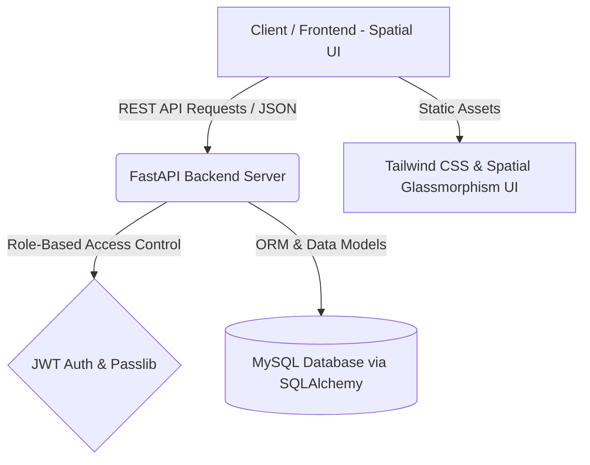

#  LabLine — Healthcare Diagnostic & Specimen Management Platform

[](https://fastapi.tiangolo.com)
[](https://www.python.org)
[](https://www.sqlalchemy.org)
[](https://www.mysql.com)
[](https://tailwindcss.com)
[](https://jwt.io)

> **LabLine** is a modern, end-to-end clinical diagnostic portal and specimen management platform designed for patients, laboratory technicians, and pathology administrators. It streamlines patient test booking, automated specimen tracking, technician queue management, reference range validation, out-of-range critical flagging, and certified report generation.

---

##  Key Features

###  1. Patient Portal
- **Interactive Test Catalog**: Search, filter, and inspect diagnostic tests (CBC, Lipid Profile, TFT, HbA1c, Liver Function, etc.) with pre-test fasting instructions and tube-cap specifications.
- **Booking & Simulated Payment Checkout**: Real-time order placement with billing breakdown and instant order generation.
- **Live Specimen Tracking**: Visual multi-stage status tracker from *Sample Collected* $\rightarrow$ *Lab In-Transit* $\rightarrow$ *Processing* $\rightarrow$ *Results Certified*.
- **Certified Diagnostic Reports**: Interactive digital report viewer with color-coded biomarker flags (Normal, Low, High, Critical) and instant PDF/print export.

###  2. Laboratory Technician Queue
- **Live Worklist & Specimen Queue**: Real-time incoming specimen prioritization with priority tags and sample tube color coding.
- **Real-Time Clinical Result Entry**: Parameter-by-parameter value input with instant auto-validation against clinical biological reference intervals.
- **Smart Flagging & Clinical Notes**: Dynamic out-of-range detection and critical value warning alerts for immediate pathologist review.

###  3. Clinical Administrator Dashboard
- **Analytical Metrics Hub**: Operational telemetry covering daily test throughput, pending queues, turnaround times, and revenue metrics.
- **Technician & Specimen Assignment**: Workload balancer to assign incoming accessions to available certified technicians.
- **Dynamic Catalog Management**: Create, edit, and configure tests, biological reference ranges, specimen tube categories, and pricing in real time.

---

##  Architecture & Tech Stack



###  Technology Breakdown

| Component | Technology | Description |
| :--- | :--- | :--- |
| **Backend Framework** | **FastAPI** (Python 3.10+) | High-performance asynchronous REST API backend |
| **Database ORM** | **SQLAlchemy + PyMySQL** | Relational mapping, connection pooling, and migrations |
| **Authentication** | **PyJWT + Passlib (bcrypt)** | Secure JSON Web Token authentication & password hashing |
| **Validation** | **Pydantic v2** | Data schema validation and strict type safety |
| **Frontend UI** | **HTML5 + Vanilla JS + CSS3** | Dynamic single-page & multi-page workflows |
| **Design System** | **Tailwind CSS + Glassmorphism** | Modern dark-mode spatial interface with custom typography |

---

##  Repository Structure

```plaintext
ddp/
├── backend/
│   ├── routers/
│   │   ├── __init__.py
│   │   ├── auth_router.py       # Authentication & user registration endpoints
│   │   ├── bookings_router.py   # Booking lifecycle, stage tracking & dispatch
│   │   ├── tests_router.py      # Test catalog CRUD, prescription parser & recommender
│   │   ├── payments_router.py   # Payment creation and verification endpoints
│   │   ├── results_router.py    # Clinical result submission and flag evaluation
│   │   ├── reports_router.py    # Diagnostic report data, PDF export & hash verification
│   │   └── analytics_router.py  # KPI summary, category breakdown & technician workload
│   ├── auth.py                  # JWT creation, decoding, and password hashing
│   ├── database.py              # SQLAlchemy engine & session configuration
│   ├── dependencies.py          # FastAPI dependencies (auth verification, DB sessions)
│   ├── main.py                  # API gateway, CORS configuration, route inclusion
│   ├── models.py                # Database models (User, Booking, Test, Payment, etc.)
│   ├── schemas.py               # Pydantic request & response schemas
│   ├── requirements.txt         # Python dependencies
│   └── .env.example             # Environment variable template
├── frontend/
│   ├── admin/
│   │   ├── assign.html          # Specimen technician assignment portal
│   │   ├── catalog-manage.html  # Dynamic test catalog administration
│   │   └── dashboard.html       # Analytics, KPI cards & lab operations
│   ├── css/
│   │   └── style.css            # Spatial glassmorphism design system & micro-animations
│   ├── js/
│   │   └── shared.js            # Clinical data store, default tests, and analytical helpers
│   ├── patient/
│   │   ├── catalog.html         # Diagnostic test browser & shopping cart
│   │   ├── payment.html         # Billing summary & checkout simulation
│   │   ├── reports.html         # Certified medical report view & print
│   │   ├── tracking.html        # Live multi-stage specimen timeline tracker
│   │   └── verify.html          # Cryptographic SHA-256 report authenticity checker
│   ├── technician/
│   │   ├── queue.html           # Lab processing queue & worklist
│   │   └── result-entry.html    # Parameter result input & reference interval validator
│   └── index.html               # Main authentication portal & landing view
├── .gitignore                   # Ignored files (venv, secrets, caches)
├── .gitattributes               # Git line-ending configuration
└── README.md                    # Project documentation
```

---

##  Getting Started

###  Prerequisites
- **Python 3.10+**
- **MySQL Server 8.0+** (or Docker MySQL container)
- **Modern Web Browser** (Chrome, Edge, Firefox, Brave)

---

###  1. Backend Setup

1. **Navigate to the backend directory**:
   ```bash
   cd backend
   ```

2. **Create and activate a virtual environment**:
   ```bash
   # Windows (PowerShell)
   python -m venv venv
   .\venv\Scripts\Activate.ps1

   # macOS / Linux
   python3 -m venv venv
   source venv/bin/activate
   ```

3. **Install dependencies**:
   ```bash
   pip install -r requirements.txt
   ```

4. **Configure Environment Variables**:
   Copy `.env.example` to `.env` and fill in your MySQL credentials:
   ```bash
   cp .env.example .env
   ```
   *Example `.env` configuration:*
   ```env
   DB_USER=root
   DB_PASSWORD=your_secure_password
   DB_HOST=localhost
   DB_PORT=3306
   DB_NAME=labline_db

   JWT_SECRET_KEY=super_secret_random_key_here
   JWT_ALGORITHM=HS256
   JWT_EXPIRE_MINUTES=1440
   ```

5. **Start the FastAPI Server**:
   ```bash
   uvicorn main:app --reload --port 8000
   ```
   - API Docs (Swagger UI): `http://127.0.0.1:8000/docs`
   - Redoc: `http://127.0.0.1:8000/redoc`

---

###  2. Frontend Setup

The frontend is a lightweight, responsive static web application with Tailwind CSS and modular JavaScript.

You can serve it with any static web server:
```bash
# Option A: VS Code Live Server extension (Right click frontend/index.html -> Open with Live Server)

# Option B: Python built-in HTTP server
cd frontend
python -m http.server 5500
```
Open your browser at `http://127.0.0.1:5500/index.html`.

---

##  User Roles & Permissions

| Role | Access Scope | Key Capabilities |
| :--- | :--- | :--- |
| **Patient** | `/patient/*` | Browse catalog, place test bookings, track sample status, view & print certified clinical reports |
| **Technician** | `/technician/*` | View assigned lab queues, input biological values, trigger auto-flagging for critical intervals |
| **Admin** | `/admin/*` | View laboratory KPI metrics, manage clinical catalog, assign tests to technicians |

---

##  Supported Diagnostic Panels

- **Complete Blood Count (CBC)**: Hemoglobin, WBC, RBC, Platelets, Packed Cell Volume (PCV).
- **Comprehensive Lipid Profile**: Total Cholesterol, Triglycerides, HDL, LDL, VLDL.
- **Thyroid Function Panel (TFT)**: Ultrasensitive TSH, Total T3, Total T4.
- **Diabetes & Glycemic Panel**: HbA1c, Estimated Average Glucose (eAG), Fasting Blood Sugar.
- **Renal & Liver Profiles**: Creatinine, BUN, SGOT/AST, SGPT/ALT, Bilirubin fractions.

---

##  Contributing

Contributions, issues, and feature requests are welcome!
1. Fork the repository
2. Create your feature branch (`git checkout -b feature/AmazingFeature`)
3. Commit your changes (`git commit -m 'Add some AmazingFeature'`)
4. Push to the branch (`git push origin feature/AmazingFeature`)
5. Open a Pull Request

---

##  License

Distributed under the **MIT License**. See `LICENSE` for more information.

---

<div align="center">
  <sub>Built with  by <a href="https://github.com/nithin16-cloud">Nithin T</a></sub>
</div>
