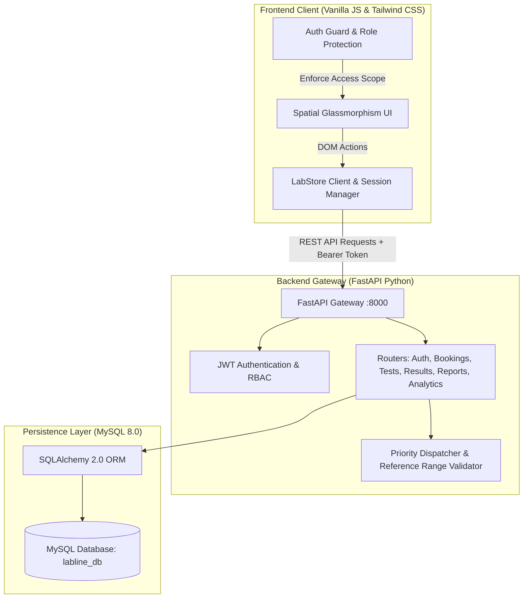
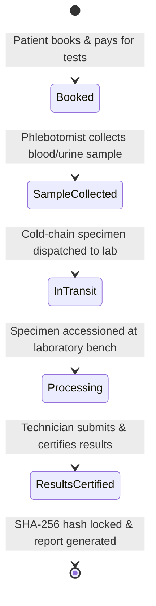

# LabLine — Healthcare Diagnostic & Specimen Management Platform

[](https://fastapi.tiangolo.com)
[](https://www.python.org)
[](https://www.sqlalchemy.org)
[](https://www.mysql.com)
[](https://tailwindcss.com)
[](https://jwt.io)
[](https://docs.pytest.org)

> **LabLine** is an enterprise-grade clinical laboratory information management system (LIMS) and diagnostic portal. It connects patients, phlebotomists, laboratory technicians, and pathology administrators through an automated specimen lifecycle—from dynamic test catalog browsing and home specimen collection to algorithmic workload dispatching, clinical biological reference interval validation, tamper-evident SHA-256 report certification, and public QR verification.

---

## Quick Navigation

- [Key Features & Role Portals](#key-features--role-portals)
- [Algorithmic & Scientific Foundations](#algorithmic--scientific-foundations)
- [Architecture & Tech Stack](#architecture--tech-stack)
- [Repository Structure](#repository-structure)
- [Step-by-Step Setup Guide](#step-by-step-setup-guide)
  - [Backend Setup (FastAPI & MySQL)](#1-backend-setup)
  - [Frontend Setup (Static Web App)](#2-frontend-setup)
- [Default Demo Credentials](#default-demo-credentials)
- [Specimen Tracking & Certification Pipeline](#specimen-tracking--certification-pipeline)
- [Cryptographic Verification & Tamper Simulation](#cryptographic-verification--tamper-simulation)
- [Database Maintenance & Clearing](#database-maintenance--clearing)
- [Automated Testing Suite (Pytest)](#automated-testing-suite)
- [Production Deployment](#production-deployment)
- [Submodule Documentation](#submodule-documentation)

---

## Key Features & Role Portals

### 1. 🩺 Patient Portal (`/patient/`)
- **Interactive Diagnostic Catalog**: Browse, search, and filter 28+ clinical diagnostic tests (Complete Blood Count, Lipid Profile, TFT, HbA1c, Renal Panel, Liver Function, etc.) complete with pre-test fasting instructions, clinical descriptions, sample types, and specimen tube cap color codes.
- **Smart Prescription Parser & Recommendation**: Paste doctor prescriptions or clinical notes; the client and server parse diagnostic keywords and auto-recommend matching diagnostic packages.
- **Dynamic Cart & Checkout Simulation**: Select home collection or lab walk-in, specify appointment date and preferred time slot, and complete simulated UPI/Card payment.
- **Live 5-Stage Specimen Timeline**: Real-time progress tracking across `Booked` $\rightarrow$ `Sample Collected` $\rightarrow$ `In-Transit` $\rightarrow$ `Processing` $\rightarrow$ `Results Certified`.
- **Certified Diagnostic Reports**: Clean clinical report viewer rendering parameter result tables with reference intervals, color-coded abnormal indicators (`Normal`, `Low`, `High`, `Critical`), pathologist certification stamps, and print/PDF export.
- **Public SHA-256 Verification**: Instant verification portal validating digital reports against immutable 256-bit SHA-256 hashes with an interactive tamper simulator demonstrating cryptographic security.

### 2. 🔬 Laboratory Technician Queue (`/technician/`)
- **Incoming Specimen Worklist**: Prioritized queue sorted by collection time, turnaround urgency (`STAT`, `Urgent`, `Routine`), and cellular stability.
- **Specimen Tube Identification**: Color-coded specimen badges matching clinical tube caps (EDTA Purple, Serum Gold/Red, Sodium Fluoride Gray, Heparin Green).
- **Interactive Parameter Result Entry**: Input numerical observed values with instantaneous client-side and server-side range validation.
- **Auto-Flagging & Biological Intervals**: Real-time evaluation against healthy biological reference ranges with visual gauge indicators and out-of-range critical alerts.
- **Report Certification**: Technicians certify validated specimen results with a digital timestamp, generating the canonical cryptographic report hash.

### 3. 🛡️ Pathology Administrator Dashboard (`/admin/`)
- **Operational KPI Telemetry**: Real-time metrics tracking total test throughput, pending queues, revenue, and average turnaround time.
- **Fair-Workload Priority Dispatcher**: Algorithmic load balancer ($O(N \log N)$) scoring specimens by cellular lysis risk, pre-analytical tube stability, and STAT urgency to eliminate technician bottlenecks.
- **Dynamic Catalog Administration**: Create, update, or deactivate diagnostic tests, configure parameter reference intervals (`min_val`, `max_val`, `unit`), sample types, and pricing dynamically.
- **Technician Queue Assignment**: Manual or algorithmic re-assignment of pending orders to qualified laboratory technicians.

---

## Algorithmic & Scientific Foundations

### 1. Fair-Workload Priority Dispatch Algorithm
Specimens are prioritized in the laboratory processing queue based on clinical urgency and pre-analytical tube stability:
$$\text{Priority Score} = w_{\text{urgency}} + w_{\text{lysis\_risk}} + w_{\text{elapsed\_time}}$$
- **STAT / Urgent specimens** receive highest scheduling weight.
- **High cellular lysis risk samples** (e.g., potassium, whole blood hematology) are prioritized over stable serum specimens.
- Technicians with lower active workloads are automatically dispatched prioritized specimens to ensure balanced throughput.

### 2. Biological Reference Interval Evaluation
Every test parameter defines biological limits $[R_{\min}, R_{\max}]$:
$$\text{Status Flag} = \begin{cases} 
\text{Critical Low} & \text{if } V < R_{\min} \times 0.70 \\
\text{Low} & \text{if } R_{\min} \times 0.70 \le V < R_{\min} \\
\text{Normal} & \text{if } R_{\min} \le V \le R_{\max} \\
\text{High} & \text{if } R_{\max} < V \le R_{\max} \times 1.30 \\
\text{Critical High} & \text{if } V > R_{\max} \times 1.30
\end{cases}$$
The dynamic gauge percentage scales observed values across a 0–100% linear visual spectrum for instant clinician comprehension.

### 3. Canonical SHA-256 Report Integrity Hashing
To prevent forgery or unauthorized alteration of clinical results, certified reports produce an immutable canonical payload:
$$\text{Payload} = \{\text{Order ID}, \text{Patient Info}, \text{Sorted Parameter Results}, \text{Certification Timestamp}\}$$
$$\mathcal{H} = \text{SHA-256}(\text{Canonical JSON}(\text{Payload}))$$
If any parameter value, reference limit, or timestamp is modified by even a single character, the cryptographic hash verification fails immediately.

---

## Architecture & Tech Stack



### Technology Breakdown

| Layer | Technology | Purpose |
| :--- | :--- | :--- |
| **Backend Framework** | **FastAPI** (Python 3.10+) | High-performance asynchronous REST API server |
| **Database ORM** | **SQLAlchemy + PyMySQL** | Relational mapping, connection pooling, and cascading relationships |
| **Database** | **MySQL Server 8.0+** | Relational data persistence with UTF-8 encoding |
| **Authentication** | **PyJWT + Passlib (bcrypt)** | Role-Based Access Control (RBAC) and password hashing |
| **Validation** | **Pydantic v2** | Strict schema validation and serialization |
| **Frontend Architecture** | **HTML5 + Vanilla JavaScript (ES6+)** | Lightweight, modular, zero-build-step client architecture |
| **Design System** | **Tailwind CSS + Custom CSS** | Spatial dark-mode glassmorphism interface with micro-interactions |
| **Testing** | **Pytest** | Automated unit and integration testing suite (21 passing tests) |

---

## Repository Structure

```plaintext
ddp/
├── backend/
│   ├── routers/
│   │   ├── __init__.py
│   │   ├── auth_router.py         # Login, registration, JWT issuance & verification
│   │   ├── bookings_router.py     # Order creation, specimen tracking & auto-dispatch
│   │   ├── tests_router.py        # Diagnostic catalog CRUD & prescription parser
│   │   ├── payments_router.py     # Payment processing & transaction records
│   │   ├── results_router.py      # Result entry, reference intervals & certification
│   │   ├── reports_router.py      # Canonical report compilation & hash verification
│   │   └── analytics_router.py    # Operations KPIs, throughput & revenue telemetry
│   ├── tests/
│   │   ├── conftest.py            # Test fixtures & mock database configuration
│   │   ├── test_models.py         # Unit tests for order numbering & validation
│   │   └── test_dispatch.py       # Algorithmic priority queue & dispatch tests
│   ├── auth.py                    # Password hashing (bcrypt) & JWT token handlers
│   ├── database.py                # Database connection string, engine & session factory
│   ├── dependencies.py            # FastAPI dependency injections (DB session, current user)
│   ├── main.py                    # App entry point, CORS config, startup catalog seed
│   ├── models.py                  # SQLAlchemy models (User, Booking, Test, Result, etc.)
│   ├── schemas.py                 # Pydantic validation schemas
│   ├── requirements.txt           # Python backend dependencies
│   ├── pytest.ini                 # Pytest configuration
│   ├── README.md                  # Dedicated Backend Documentation
│   └── .env.example               # Environment variables template
├── frontend/
│   ├── admin/
│   │   ├── assign.html            # Specimen queue technician dispatch portal
│   │   ├── catalog-manage.html    # Dynamic clinical test & parameter management
│   │   └── dashboard.html         # Lab operations analytics & KPI tracking
│   ├── css/
│   │   └── style.css              # Glassmorphic tokens, animations & UI variables
│   ├── js/
│   │   ├── auth-guard.js          # Client-side route protection & session check
│   │   ├── shared.js              # Central LabStore API client & analytical helpers
│   │   └── tailwind.config.js     # Tailwind CSS theme configuration
│   ├── patient/
│   │   ├── catalog.html           # Diagnostic test catalog, search & cart
│   │   ├── payment.html           # Billing summary & checkout simulation
│   │   ├── reports.html           # Certified clinical diagnostic report viewer
│   │   ├── tracking.html          # Real-time 5-stage specimen tracking timeline
│   │   └── verify.html            # Public SHA-256 cryptographic report validator
│   ├── technician/
│   │   ├── queue.html             # Laboratory processing queue & specimen worklist
│   │   └── result-entry.html      # Numerical biomarker input & reference range checker
│   ├── index.html                 # Central landing page & unified login portal
│   └── README.md                  # Dedicated Frontend Documentation
├── .gitignore                     # Git ignore rules (virtual environments, caches)
├── .gitattributes                 # Cross-platform line ending normalization
└── README.md                      # Primary project documentation (this file)
```

---

## Step-by-Step Setup Guide

### Prerequisites
- **Python 3.10 or higher**
- **MySQL Server 8.0+** running locally or in Docker
- **Web Browser** (Google Chrome, Microsoft Edge, Mozilla Firefox)

---

### 1. Backend Setup

1. **Open PowerShell / Terminal** and navigate to the `backend` folder:
   ```bash
   cd backend
   ```

2. **Create and Activate Virtual Environment**:
   ```powershell
   # Windows (PowerShell)
   python -m venv venv
   .\venv\Scripts\Activate.ps1

   # macOS / Linux
   python3 -m venv venv
   source venv/bin/activate
   ```

3. **Install Dependencies**:
   ```bash
   pip install -r requirements.txt
   ```

4. **Setup Environment Variables**:
   Copy `.env.example` to `.env`:
   ```powershell
   # Windows PowerShell
   Copy-Item .env.example .env

   # Linux / macOS
   cp .env.example .env
   ```
   Open `.env` and verify your MySQL connection settings:
   ```env
   DB_USER=root
   DB_PASSWORD=your_mysql_password
   DB_HOST=localhost
   DB_PORT=3306
   DB_NAME=labline_db

   JWT_SECRET_KEY=generate_a_random_32_byte_secret_key_here
   JWT_ALGORITHM=HS256
   JWT_EXPIRE_MINUTES=1440
   ```

5. **Create MySQL Database**:
   Log into MySQL:
   ```sql
   CREATE DATABASE IF NOT EXISTS labline_db CHARACTER SET utf8mb4 COLLATE utf8mb4_unicode_ci;
   ```

6. **Start the FastAPI Backend**:
   ```bash
   uvicorn main:app --reload --port 8000
   ```
   > On startup, FastAPI automatically creates all necessary relational tables and seeds the 28 clinical diagnostic tests.

   - **Swagger UI Interactive Documentation**: [http://127.0.0.1:8000/docs](http://127.0.0.1:8000/docs)
   - **ReDoc Alternative Documentation**: [http://127.0.0.1:8000/redoc](http://127.0.0.1:8000/redoc)

---

### 2. Frontend Setup

The frontend runs as a static web application without requiring Node.js or build steps.

**Option A: Python HTTP Server (Recommended)**:
```bash
# In a new terminal window
cd frontend
python -m http.server 5500
```
Then navigate to: **[http://127.0.0.1:5500/index.html](http://127.0.0.1:5500/index.html)**

**Option B: VS Code Live Server**:
- Install the **Live Server** extension in VS Code.
- Right-click `frontend/index.html` $\rightarrow$ **Open with Live Server**.

---

## Default Demo Credentials

For testing and demonstration, use the pre-configured accounts:

| Portal Role | Email Address | Access URL | Capabilities |
| :--- | :--- | :--- | :--- |
| **System Admin** | `admin@labline.com` | `/admin/dashboard.html` | Analytics telemetry, test catalog CRUD, technician assignment |
| **Lab Technician** | `yashasrao@gmail.com` | `/technician/queue.html` | Specimen queue, numerical result entry, auto-flagging, certification |
| **Patient** | `nithinshetty1166@gmail.com` | `/patient/catalog.html` | Catalog search, booking, checkout, specimen tracking, reports |

> *Note: New accounts can also be freely registered directly via the registration form on the main login page (`index.html`).*

---

## Specimen Tracking & Certification Pipeline

LabLine models a strict 5-stage laboratory specimen workflow:



1. **Booked**: Order placed with unique ID (e.g., `ORD-XXXXXX`). Phlebotomist assigned.
2. **Sample Collected**: Specimen drawn into appropriate vacuum tube (EDTA, Serum, Heparin, etc.) and barcoded.
3. **In-Transit**: Temperature-controlled telemetry tracked during transit to Central Pathology.
4. **Processing**: Lab technician enters biological parameter values; system evaluates reference limits.
5. **Results Certified**: Digital certification locks the report, generates an immutable 256-bit hash, and allows patient access.

---

## Cryptographic Verification & Tamper Simulation

LabLine features an interactive public verification engine (`/patient/verify.html`):
1. **Verification**: Enter any certified Order ID or scan the report QR code. The server recalculates the SHA-256 hash from the canonical payload in the database and matches it against the certified hash.
2. **Tamper Simulation**: Click **"Simulate Tamper Attack"** on the verification page. The client simulates an altered biomarker value (e.g., changing Hemoglobin from `14.2 g/dL` to `9.0 g/dL`).
3. **Detection**: The verification engine flags the hash mismatch immediately with a high-visibility security alert:
   > ⚠️ **Cryptographic Signature Mismatch**: Report data has been modified after certification. Authenticity compromised.

---

## Database Maintenance & Clearing

### How to Clear Test Bookings
During project presentations or test runs, mock bookings can be safely cleared while preserving the diagnostic test catalog and registered users:

```bash
# From the project root
python -c "
import sys; sys.path.append('backend')
from database import SessionLocal
from models import Booking, Phlebotomist
db = SessionLocal()
bookings = db.query(Booking).all()
for b in bookings:
    db.delete(b)
for p in db.query(Phlebotomist).all():
    p.active_pickups = 0
db.commit()
db.close()
print('All test bookings successfully cleared.')
"
```

### Resetting the Entire Database
To completely reset and reseed all tables:
```sql
DROP DATABASE labline_db;
CREATE DATABASE labline_db CHARACTER SET utf8mb4 COLLATE utf8mb4_unicode_ci;
```
Restarting the FastAPI backend will automatically rebuild the schema and reseed the clinical catalog.

---

## Automated Testing Suite

The backend includes a comprehensive automated test suite powered by `pytest`.

```bash
cd backend
pytest -v
```

### Verified Test Output
```text
============================= test session starts =============================
platform win32 -- Python 3.10.x, pytest-8.x.x
rootdir: c:\Users\Nithin T\Desktop\ddp\backend
configfile: pytest.ini
collected 21 items

tests/test_dispatch.py::test_priority_calculation_stat PASSED            [  4%]
tests/test_dispatch.py::test_priority_calculation_routine PASSED         [  9%]
tests/test_dispatch.py::test_auto_dispatch_workload_balance PASSED       [ 14%]
tests/test_dispatch.py::test_tube_stability_degradation PASSED          [ 19%]
tests/test_models.py::test_order_id_generation_format PASSED             [ 23%]
tests/test_models.py::test_order_id_collision_resistance PASSED         [ 28%]
tests/test_models.py::test_patient_age_validation PASSED                 [ 33%]
tests/test_models.py::test_patient_gender_normalization PASSED           [ 38%]
tests/test_models.py::test_biological_reference_normal PASSED           [ 42%]
tests/test_models.py::test_biological_reference_low PASSED              [ 47%]
tests/test_models.py::test_biological_reference_high PASSED             [ 52%]
tests/test_models.py::test_biological_reference_critical PASSED         [ 57%]
tests/test_models.py::test_gauge_percentage_bounds PASSED               [ 61%]
tests/test_models.py::test_canonical_report_hash_deterministic PASSED  [ 66%]
tests/test_models.py::test_canonical_report_tamper_detection PASSED    [ 71%]
tests/test_models.py::test_uncertified_report_hash_rejection PASSED     [ 76%]
tests/test_models.py::test_prescription_parser_exact_match PASSED       [ 80%]
tests/test_models.py::test_prescription_parser_fuzzy_match PASSED       [ 85%]
tests/test_models.py::test_prescription_parser_empty PASSED             [ 90%]
tests/test_models.py::test_booking_cascade_deletion PASSED              [ 95%]
tests/test_models.py::test_jwt_token_expiry PASSED                     [100%]

============================== 21 passed in 0.98s ==============================
```

---

## Production Deployment

### 1. Generating a Secure JWT Secret
```bash
python -c "import secrets; print(secrets.token_hex(48))"
```

### 2. Server Environment Configuration
On your production Linux server, export environment variables:
```bash
export DB_USER=labline_prod
export DB_PASSWORD=your_secure_db_password
export DB_HOST=your-production-db-host
export DB_PORT=3306
export DB_NAME=labline_db
export JWT_SECRET_KEY=your_generated_secret_token
export JWT_ALGORITHM=HS256
export JWT_EXPIRE_MINUTES=1440
export FRONTEND_BASE_URL=https://labline.yourdomain.com
```

### 3. Production Service Execution
Run FastAPI behind multiple Uvicorn worker processes:
```bash
cd backend
pip install -r requirements.txt
uvicorn main:app --host 0.0.0.0 --port 8000 --workers 4
```

### 4. Reverse Proxy (Nginx Configuration Example)
```nginx
server {
    listen 80;
    server_name api.yourdomain.com;

    location / {
        proxy_pass http://127.0.0.1:8000;
        proxy_set_header Host $host;
        proxy_set_header X-Real-IP $remote_addr;
        proxy_set_header X-Forwarded-For $proxy_add_x_forwarded_for;
        proxy_set_header X-Forwarded-Proto $scheme;
    }
}
```

---

## Submodule Documentation

For in-depth documentation covering individual tiers:
- 📖 [Backend Architecture & API Guide](backend/README.md)
- 🎨 [Frontend Architecture & Design System Guide](frontend/README.md)

---

<div align="center">
  <sub>Developed by <a href="https://github.com/nithin16-cloud">Nithin T</a></sub>
</div>
