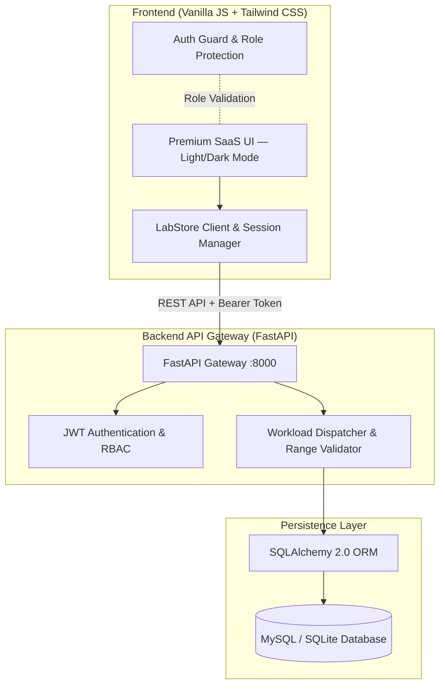

# LabLine — Clinical Diagnostic & Specimen Intelligence Platform

[](https://labline-8p02.onrender.com)
[](https://fastapi.tiangolo.com)
[](https://www.python.org)
[](https://www.sqlalchemy.org)
[](https://tailwindcss.com)
[](https://jwt.io)

> **LabLine** is an enterprise-grade clinical Laboratory Information Management System (LIMS) and diagnostic portal. It unifies patients, phlebotomists, laboratory technicians, and pathology administrators into a single automated specimen lifecycle — with intelligent workload balancing, clinical reference range validation, tamper-evident SHA-256 report verification, user management, and a premium SaaS-grade web UI with full light/dark mode.
>
> **Live Demo:** [https://labline-8p02.onrender.com](https://labline-8p02.onrender.com)

---

## Live Demo & Deployment

LabLine is deployed on **Render** using a unified container architecture serving both the FastAPI REST engine and the static frontend client from a single origin.

| Resource | Link | Description |
| :--- | :--- | :--- |
| **Full-Stack Web App** | [labline-8p02.onrender.com](https://labline-8p02.onrender.com) | Unified clinical diagnostic & management platform |
| **Interactive API Docs** | [/docs](https://labline-8p02.onrender.com/docs) | OpenAPI Swagger documentation & API testing console |
| **Health Monitor** | [/health](https://labline-8p02.onrender.com/health) | Real-time JSON health check & database telemetry |
| **Cryptographic Verifier** | [/patient/verify.html](https://labline-8p02.onrender.com/patient/verify.html) | Public SHA-256 report anti-tamper verification tool |

> **Note on cold starts:** LabLine is deployed on Render's free tier. If the server is sleeping, the first request may take 30-60 seconds to wake up. A "Waking up server..." indicator appears on the login page during this time.

---

## Role Portals

| Portal | Audience | Key Features |
| :--- | :--- | :--- |
| **Patient Portal** | Patients & Clients | 28+ test catalog, smart prescription keyword parser, appointment slot booking, 5-stage specimen tracking, PDF report downloads, QR verification |
| **Lab Workstation** | Technicians | Urgency-sorted worklist, specimen tube identification (EDTA / Serum / Heparin), biomarker entry with real-time range validation, one-click cryptographic certification |
| **Admin Console** | Pathology Directors | Real-time operations KPIs, phlebotomist dispatch, test catalog management, user directory with Gmail/email visibility and account removal with audit logging |

---

## System Architecture



### Technology Stack

| Layer | Technology |
| :--- | :--- |
| **Backend** | FastAPI (Python 3.10+), Uvicorn ASGI |
| **ORM & Database** | SQLAlchemy 2.0, MySQL 8.0 / SQLite (dev) |
| **Security** | PyJWT (HS256 bearer tokens), Passlib (bcrypt hashing) |
| **Validation** | Pydantic v2 |
| **Frontend** | Semantic HTML5, Vanilla ES6+, Tailwind CSS CDN, Custom CSS Design System |
| **Design System** | CSS custom properties (tokens), Inter + JetBrains Mono, 8px spacing scale, WCAG AA contrast |
| **Reports** | ReportLab PDF generation + browser print |
| **DevOps** | Docker, Docker Compose, Render Procfile |

---

## Specimen Lifecycle

### Five-Stage Pipeline
```
[Booked] -> [Sample Collected] -> [In-Transit] -> [Processing] -> [Results Certified]
```

1. **Booked** — Order created with unique accession ID (`ORD-XXXXXX`) and phlebotomist allocated.
2. **Sample Collected** — Specimen drawn in color-coded vacuum tubes (Purple EDTA, Gold Serum, Green Heparin) and barcoded.
3. **In-Transit** — Specimen tracked with temperature and transit telemetry.
4. **Processing** — Technician enters observed biomarker values; system validates against biological reference limits and flags abnormals.
5. **Results Certified** — Report locked with a digital stamp and immutable SHA-256 signature.

### Cryptographic Verification
Every certified report generates a deterministic canonical JSON digest. If any result, reference value, or timestamp changes by even a single character, the public `/patient/verify.html` validator immediately flags a cryptographic mismatch.

---

## Authentication & User Flows

### Patient Sign-In (Auto-Provisioning)
Patients do not need a separate registration step. On first sign-in, entering any email and password automatically creates a patient account in the backend. The login page shows a clear contextual helper note explaining this. Subsequent sign-ins use the stored credentials normally.

### Staff Accounts
- **Administrator** — seeded server-side on startup via `ADMIN_EMAIL` / `ADMIN_PASSWORD` environment variables.
- **Technician** — seeded server-side on startup via `TECH_EMAIL` / `TECH_PASSWORD` environment variables.
- Staff accounts cannot be registered via public sign-in. Attempting to register an admin or technician via the public API returns `HTTP 403 Forbidden`.

### User Management (Admin)
The Administrator Console **User Data** page shows:
- All registered user accounts with their Gmail/email addresses, roles, sign-up dates, and login counts.
- A **Remove** button to permanently delete any non-admin user account.
- Protection against self-deletion (the active admin account is always protected with a badge).
- All deletion events are recorded in the immutable security audit log.

---

## Quickstart

### Option A: Docker Compose (Recommended)
```bash
git clone https://github.com/nithin16-cloud/labline.git
cd labline
docker compose up --build
```
Open [http://localhost:8000/](http://localhost:8000/)

---

### Option B: Local Development

#### 1. Backend Setup
```bash
cd backend
python -m venv venv

# Windows
.\\venv\\Scripts\\Activate.ps1
# macOS / Linux
source venv/bin/activate

pip install -r requirements.txt
cp .env.example .env
uvicorn main:app --reload --port 8000
```

The FastAPI server auto-detects `../frontend` and serves the entire UI at **[http://127.0.0.1:8000/](http://127.0.0.1:8000/)**. Database tables and initial test catalogs are seeded automatically on first launch.

#### 2. Optional: Decoupled Frontend Dev Server
```bash
cd frontend
python -m http.server 5500
```
Open [http://127.0.0.1:5500/index.html](http://127.0.0.1:5500/index.html). The client auto-discovers the backend at `http://127.0.0.1:8000`.

---

### Cloud Deployment

LabLine is deployed live on Render using the unified root `Dockerfile`.

#### Render / Railway / Fly.io
1. Fork or push this repository to GitHub.
2. Create a new **Web Service** connected to your repository.
3. Set environment variables:
   - `DATABASE_URL` — hosted MySQL or PostgreSQL connection string (omit for SQLite).
   - `JWT_SECRET_KEY` — secure 32+ character random secret.
   - `ENVIRONMENT` — `production`
   - `ADMIN_EMAIL` and `ADMIN_PASSWORD` — initial administrator credentials.
   - `TECH_EMAIL` and `TECH_PASSWORD` — initial technician credentials.
4. The service builds via the root `Dockerfile`, runs on `$PORT`, and serves both the API and the frontend from a single origin.

#### Decoupled (Vercel / Netlify + Backend PaaS)
- Deploy `frontend/` to Vercel or Netlify as a static site (no build command required).
- Deploy `backend/` to Render or Railway.
- Set the backend URL by passing `?api=https://your-backend.onrender.com` in the URL, or add `<meta name="labline-api-base" content="https://your-backend.onrender.com">` in `frontend/index.html`.

---

## Running Tests
```bash
cd backend
python -m pytest tests/
```

The test suite covers booking logic, clinical range validation, cryptographic report hashing, patient input validation, and the full user deletion workflow (RBAC enforcement, self-deletion protection, audit log recording).

---

## Repository Structure

```
ddp/
├── backend/
│   ├── routers/               # Modular API routes (Auth, Bookings, Tests, Results, Users, Analytics)
│   ├── middleware/            # Security headers & auth rate limiting
│   ├── services/              # Seed service for initial data
│   ├── tests/                 # pytest test suite (22 tests)
│   ├── auth.py                # Password hashing & JWT token security
│   ├── config.py              # Environment-based settings
│   ├── database.py            # Database engine & connection pooling
│   ├── dependencies.py        # RBAC & database session injection
│   ├── main.py                # App entry point, CORS, middleware & startup seed
│   ├── models.py              # SQLAlchemy relational models
│   ├── schemas.py             # Pydantic v2 validation schemas
│   ├── Dockerfile             # Production container recipe
│   ├── Procfile               # Cloud PaaS process definition
│   └── requirements.txt       # Python dependencies
├── frontend/
│   ├── admin/                 # Administrator console (dashboard, dispatch, catalog, users)
│   ├── patient/               # Patient portal (catalog, summary, confirmation, tracking, reports, verify)
│   ├── technician/            # Lab workstation (queue, result entry)
│   ├── assets/                # Favicons & brand assets
│   ├── css/style.css          # Shared design system (CSS variables, tokens, components)
│   ├── js/
│   │   ├── shared.js          # LabStore API client, session manager & utilities
│   │   ├── shockwave.js       # 60fps canvas animation engine (login page brand panel)
│   │   ├── auth-guard.js      # Client-side role protection
│   │   └── tailwind.config.js # Tailwind design token bridge
│   └── index.html             # Login portal (split-panel premium design)
├── scripts/                   # Database maintenance & purge scripts
├── docker-compose.yml         # Multi-container deployment
└── README.md                  # Project documentation
```

---

## Design System

LabLine uses a custom CSS variable-based design system without a third-party UI library:

- **Palette** — Near-white neutral base (`#f8fafc`), confident teal accent (`#0d9488`), with red / amber / green reserved strictly for clinical result flags and status badges.
- **Typography** — Inter for UI text, JetBrains Mono for codes and data values.
- **Spacing** — Strict 8px scale (`--space-2` through `--space-16`).
- **Themes** — Full light and dark mode via `data-theme` attribute on `<html>`, with system preference detection and anti-FOUC via an inline script in every page head.
- **Accessibility** — WCAG AA contrast enforced across both themes. Keyboard accessible. `aria-label` and `role` attributes throughout.
- **Animations** — Subtle and purposeful. Login panel features a 60fps canvas shockwave engine, ECG rhythm trace, floating diagnostic silhouettes, and a geometric hexagonal grid overlay.

---

## Security

- **JWT Bearer Tokens** — HS256, 24-hour expiry, stored in `localStorage`.
- **Bcrypt Password Hashing** — Passlib; plaintext never stored or logged.
- **RBAC** — every protected endpoint uses `require_role()` dependency injection.
- **Rate Limiting** — brute-force protection on all authentication endpoints.
- **Security Headers** — `X-Content-Type-Options`, `X-Frame-Options`, `Referrer-Policy`, and `Content-Security-Policy` via custom middleware.
- **Audit Log** — sign-in, failed login, sign-up, and account deletion events recorded immutably in `user_activity` with timestamps, IP addresses, and user agents.
- **Self-Deletion Guard** — the active administrator account cannot be deleted through the User Management console.

---

<div align="center">
  Developed by <a href="https://github.com/nithin16-cloud">Nithin T</a>
</div>
