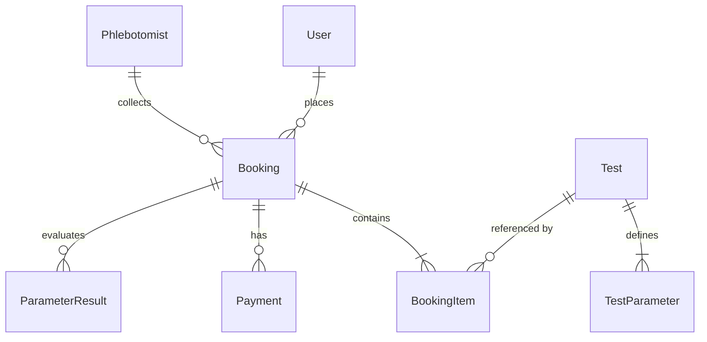

# LabLine Backend — REST API & Laboratory Engine

[](https://fastapi.tiangolo.com)
[](https://python.org)
[](https://sqlalchemy.org)
[](https://mysql.com)
[](https://pytest.org)

The **LabLine Backend** is a high-performance asynchronous REST API built with **FastAPI**, **SQLAlchemy ORM**, **Pydantic v2**, and **MySQL**. It powers real-time specimen tracking, algorithmic laboratory dispatching, clinical biological reference interval validation, and cryptographic SHA-256 diagnostic report certification.

---

## Architecture Overview

```plaintext
backend/
├── routers/
│   ├── auth_router.py         # User registration, login, JWT token verification
│   ├── bookings_router.py     # Booking lifecycle, status updates, 5-stage tracking, dispatch
│   ├── tests_router.py        # Diagnostic catalog management, prescription OCR parsing
│   ├── payments_router.py     # Simulated payment processing & transaction verification
│   ├── results_router.py      # Numerical parameter entry, biological reference validation, certification
│   ├── reports_router.py      # Canonical report compilation, SHA-256 verification, PDF data
│   └── analytics_router.py    # Operational KPIs, daily throughput, revenue telemetry
├── tests/
│   ├── conftest.py            # SQLite in-memory test database fixture & test client
│   ├── test_models.py         # Tests for collision resistance, range checks, hash verification
│   └── test_dispatch.py       # Tests for priority calculations & auto-dispatch load balancing
├── auth.py                    # Bcrypt hashing & PyJWT token creation/decoding
├── database.py                # SQLAlchemy engine connection & DB session lifecycle
├── dependencies.py            # FastAPI dependency injection (get_db, get_current_user, require_role)
├── main.py                    # Application gateway, CORS middleware, startup catalog seed
├── models.py                  # SQLAlchemy relational models & cascading constraints
├── schemas.py                 # Pydantic v2 data schemas for requests and responses
├── pytest.ini                 # Pytest configuration and warning filters
├── requirements.txt           # Python dependency manifest
└── .env.example               # Environment variables template
```

---

## Relational Data Models

The database schema (`models.py`) defines 8 primary tables with cascading foreign keys:



1. **`users`**: System accounts with role-based access (`patient`, `technician`, `admin`).
2. **`tests`**: Diagnostic catalog tests (CBC, Lipid Profile, TFT, HbA1c, etc.) with tube-cap specifications and turnaround times.
3. **`test_parameters`**: Individual biomarkers (e.g., Hemoglobin, Fasting Blood Sugar) with biological reference intervals (`min_val`, `max_val`, `unit`).
4. **`bookings`**: Diagnostic orders tracking patient details, collection type, 5-stage specimen timeline, and certified report hash.
5. **`booking_items`**: Line items associating diagnostic tests with bookings (`cascade="all, delete-orphan"`).
6. **`payments`**: Payment records storing simulated transaction IDs, methods (UPI/Card), and amounts.
7. **`parameter_results`**: Numerical results submitted by technicians, storing observed values, flags (`Normal`, `Low`, `High`, `Critical`), and gauge marker percentages.
8. **`phlebotomists`**: Home collection personnel tracking active pickups and service ratings.

---

## API Endpoints Reference

### 1. Authentication (`/auth`)
- `POST /auth/register` — Register a new patient, technician, or administrator.
- `POST /auth/login` — Authenticate credentials and receive a signed JWT access token.
- `GET /auth/me` — Retrieve current authenticated user profile.

### 2. Diagnostic Catalog (`/tests`)
- `GET /tests` — List all active diagnostic tests with biological parameters.
- `GET /tests/{test_id}` — Retrieve details of a specific diagnostic panel.
- `POST /tests` *(Admin only)* — Create a new diagnostic test and configure parameters.
- `PUT /tests/{test_id}` *(Admin only)* — Update reference intervals, pricing, or turnaround time.
- `DELETE /tests/{test_id}` *(Admin only)* — Deactivate or soft-delete a diagnostic test.
- `POST /tests/parse-prescription` — Smart semantic search matching extracted prescription text against the catalog.

### 3. Bookings & Specimen Tracking (`/bookings`)
- `POST /bookings` — Create a new diagnostic booking.
- `GET /bookings` — List bookings (filtered by user role).
- `GET /bookings/{booking_id}` — Retrieve full order metadata, specimen telemetry, and stage timeline.
- `PUT /bookings/{booking_id}/stage` *(Technician/Admin)* — Advance specimen stage (`Booked` $\rightarrow$ `Sample Collected` $\rightarrow$ `In-Transit` $\rightarrow$ `Processing` $\rightarrow$ `Results Certified`).
- `PUT /bookings/{booking_id}/assign` *(Admin)* — Assign booking to a specific technician.
- `POST /bookings/auto-dispatch` *(Admin)* — Execute priority load-balancing dispatch algorithm.

### 4. Result Entry & Certification (`/results`)
- `POST /results/{booking_id}` *(Technician)* — Submit observed biomarker parameters. Validates values against biological intervals and triggers abnormal/critical flags.
- `POST /results/{booking_id}/certify` *(Technician)* — Sign and certify report results. Computes the immutable SHA-256 canonical hash.

### 5. Reports & Cryptographic Verification (`/reports`)
- `GET /reports/{booking_id}` — Retrieve certified clinical report data with color-coded biomarker flags.
- `GET /reports/{booking_id}/verify` — Verify report integrity against the SHA-256 hash.
- `POST /reports/{booking_id}/simulate-tamper` — Simulates unauthorized modification of results to demonstrate tamper detection.

### 6. Analytics (`/analytics`)
- `GET /analytics/dashboard` *(Admin)* — Overview metrics (total orders, revenue, turnaround time, pending queue count).
- `GET /analytics/throughput` *(Admin)* — Daily test processing volume.

---

## Getting Started

### 1. Environment Setup
```powershell
# Windows
python -m venv venv
.\venv\Scripts\Activate.ps1

# Linux / macOS
python3 -m venv venv
source venv/bin/activate
```

### 2. Install Requirements
```bash
pip install -r requirements.txt
```

### 3. Configure Database
Create your local MySQL database:
```sql
CREATE DATABASE labline_db CHARACTER SET utf8mb4 COLLATE utf8mb4_unicode_ci;
```

Copy the `.env.example` file:
```bash
cp .env.example .env
```
Update your credentials in `.env`:
```env
DB_USER=root
DB_PASSWORD=your_password
DB_HOST=localhost
DB_PORT=3306
DB_NAME=labline_db

JWT_SECRET_KEY=super_secret_jwt_key_32_bytes_long
JWT_ALGORITHM=HS256
JWT_EXPIRE_MINUTES=1440
```

### 4. Run Development Server
```bash
uvicorn main:app --reload --port 8000
```
- Interactive Swagger UI: [http://127.0.0.1:8000/docs](http://127.0.0.1:8000/docs)
- Interactive ReDoc: [http://127.0.0.1:8000/redoc](http://127.0.0.1:8000/redoc)

---

## Maintenance & Database Utilities

### Clear Test Bookings
To clear test orders (e.g., after presentations) without affecting registered users or the diagnostic catalog:
```powershell
python -c "
import sys; sys.path.append('.')
from database import SessionLocal
from models import Booking, Phlebotomist
db = SessionLocal()
for b in db.query(Booking).all(): db.delete(b)
for p in db.query(Phlebotomist).all(): p.active_pickups = 0
db.commit(); db.close()
print('Cleared all test bookings.')
"
```

---

## Running the Automated Test Suite

```bash
pytest -v
```

All 21 unit and integration tests validate:
- Algorithmic specimen priority dispatch ($O(N \log N)$)
- Tube stability degradation over transit time
- Order ID format and collision resistance
- Reference interval boundary conditions (`Normal`, `Low`, `High`, `Critical`)
- Canonical JSON SHA-256 deterministic hash calculations
- Cryptographic tamper detection and rejection of uncertified modifications
- Prescription parser exact and fuzzy semantic matching
- Cascading delete integrity across orders, payments, and results
